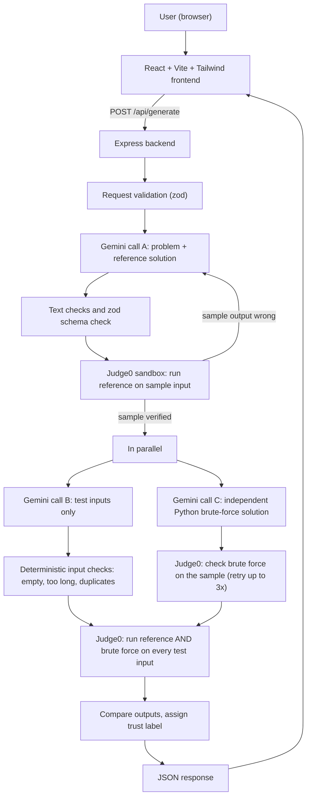

# CodeForge AI: AI-Powered Coding Problem Generator with Automated Test Cases

A full-stack Generative AI application that creates programming problems on a chosen topic, difficulty, and language, then **checks its own output** by running code in a sandbox instead of trusting the model.

BTech CSE, Generative AI end-semester project (Topic 82).

## What it does

1. The user picks a topic, difficulty, language (C++, Python, Java, JavaScript), and optional instructions.
2. An LLM (Google Gemini) generates a structured problem: statement, input/output format, constraints, sample, reference solution, and complexity.
3. The backend runs the reference solution on the sample input in a sandbox and compares the result with the sample output the AI claimed. If they differ, the problem is discarded and regenerated (up to 3 attempts).
4. The LLM writes 8 test **inputs** (basic, normal, boundary, edge, challenging). It does **not** write expected outputs.
5. A second, independent LLM call writes a simple brute-force solution in Python.
6. Both solutions run on every test input in the sandbox. A test is labelled **Verified** only when both outputs agree.
7. The UI shows the problem, the solutions, every test with its trust label, and a validation report.

## Architecture



Backend, AI integration, and code execution are separate modules. API keys exist only on the server.

## Trust labels

| Label | Meaning |
|---|---|
| **Verified** | Reference and independent brute-force solutions produced the same output. That output becomes the expected output. |
| **Disputed** | The two solutions disagree. One of them, or the problem statement, is wrong. Shown openly. |
| **Unverified** | Only one solution produced an answer, or the problem's own sample check failed. No second opinion. |
| **Error** | The reference solution crashed, timed out, or failed to compile. |

Expected outputs are **never written by the AI**. They come from running code in the sandbox.

## Tech stack

| Layer | Technology |
|---|---|
| Frontend | React, Vite, Tailwind CSS, Lucide icons, react-syntax-highlighter |
| Backend | Node.js, Express, zod |
| LLM | Google Gemini API (JSON output mode, retries, model fallback) |
| Sandbox | Judge0 CE public instance (https://ce.judge0.com) |
| Storage | None in this version. Results can be saved as JSON files from the UI. |

## Project structure

```
coding-problem-generator/
├── backend/
│   └── src/
│       ├── config/        env.js, languages.js (Judge0 language IDs)
│       ├── routes/        health, generate
│       ├── middleware/    request validation, error handler
│       ├── schemas/       zod schemas for requests, problems, tests
│       ├── services/
│       │   ├── llm/       geminiProvider.js, prompts.js
│       │   ├── judge0.service.js
│       │   ├── pipeline.service.js
│       │   └── validator.service.js
│       └── utils/         output normalisation
└── frontend/
    └── src/
        ├── api/           backend client
        ├── components/    form, loading, problem, tests, report
        ├── demo/          saved results for offline demos
        └── hooks/
```

## Running it locally

Requirements: Node.js 18 or newer, a Gemini API key from Google AI Studio.

**1. Backend**

```bash
cd backend
npm install
```

Create `backend/.env`:

```
PORT=5000
NODE_ENV=development
CLIENT_URL=http://localhost:5173
LLM_PROVIDER=gemini
GEMINI_API_KEY=your_key_here
GEMINI_MODEL=gemini-3.5-flash-lite
JUDGE0_URL=https://ce.judge0.com
```

```bash
npm run dev
```

**2. Frontend**

```bash
cd frontend
npm install
```

Create `frontend/.env`:

```
VITE_API_URL=http://localhost:5000
```

```bash
npm run dev
```

Open http://localhost:5173.

Gemini model names are retired and replaced often. If you get a "model not found" error, change `GEMINI_MODEL` to a current model name from the AI Studio documentation.

## Offline demos

The UI has an **Offline demos** panel with three saved results (Easy, Medium, and a Hard one flagged unreliable). They load without a backend or internet and are labelled as saved results, not live generations.

## Limitations

- **Verified is not proof of correctness.** Two solutions agreeing lowers the risk of wrong outputs, but both can share the same misreading of the problem.
- **The checks measure consistency, not quality.** A problem can pass every check and still be vaguely worded or trivial. Some generated tests are weak, for example one with no output.
- **Hard problems are less reliable.** Hard graph and tree problems often fail the sample check or produce disputed tests. The app reports this instead of hiding it.
- **Easy problems tend toward standard patterns.** Story themes vary, but the underlying algorithms often repeat.
- **Text leaks are filtered by keywords.** A phrase filter catches common "thinking aloud" text and LaTeX leftovers, but cannot catch every phrasing.
- **The sandbox is a free public service.** Its rate limits and availability are outside our control. If it is unreachable, the app reports "unavailable" instead of faking results.
- **Brute-force solutions are always Python** and use the standard library only.
- A full generation takes roughly 30 to 90 seconds.

## Safety notes

- AI-generated code is never executed on the application server. It runs only inside the Judge0 sandbox.
- API keys are read from environment variables and are never sent to the browser. `.env` is in `.gitignore`.
- Incoming requests are validated with zod, and malformed AI responses are rejected and retried.